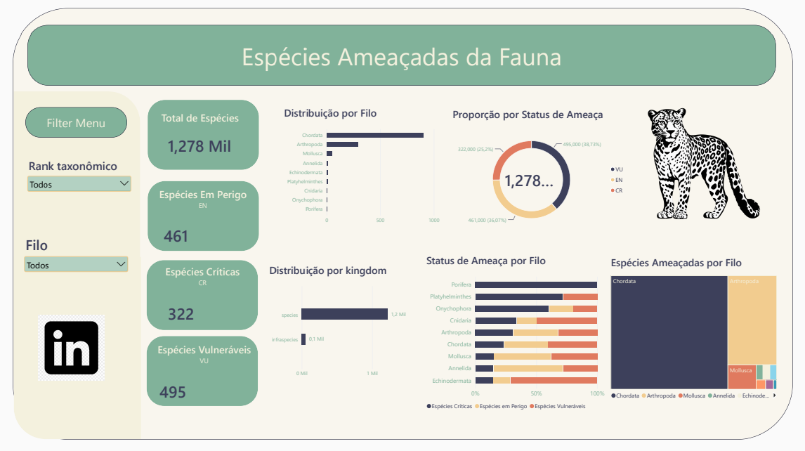

# 🐾 Analytics & BI - Espécies Ameaçadas da Fauna Brasileira

Este repositório contém a solução completa de Engenharia e Análise de Dados para o monitoramento de espécies da fauna brasileira ameaçadas de extinção, desenvolvida como projeto do curso de MBA em Ciência de Dados e BI.

A arquitetura abrange desde a ingestão de dados abertos no formato **Darwin Core Archive (DwC-A)** do ICMBio/MMA, passando pelo pipeline de ETL (**Pentaho Data Integration**), armazenagem estruturada em banco relacional (**PostgreSQL**), validação estatística em **Python (Jupyter Notebook)** até a criação do dashboard interativo no **Power BI**.
## 📊 Pré-visualização do Dashboard (Power BI)

Abaixo está a estrutura visual do dashboard desenvolvido para a análise das espécies ameaçadas da fauna brasileira:



### Como Visualizar o Relatório:
1. Certifique-se de que tem o **PostgreSQL** a correr localmente com a base de dados `fauna_db` populada.
2. Faça o download do ficheiro [`BI_Fauna_Brasileira.pbix`](./BI_Fauna_Brasileira.pbix) disponível neste repositório.
3. Abra o ficheiro no **Power BI Desktop**.
---

## 📋 Sumário
1. [Visão Geral do Projeto](#-visão-geral-do-projeto)
2. [Arquitetura e Tecnologias](#-arquitetura-e-tecnologias)
3. [Modelo de Dados (Star Schema)](#-modelo-de-dados-star-schema)
4. [Pipeline de ETL & Tratamento](#-pipeline-de-etl--tratamento)
5. [Análise Exploratória de Dados (Python)](#-análise-exploratória-de-dados-python)
6. [Métricas de Negócio & Fórmulas DAX](#-métricas-de-negócio--fórmulas-dax)
7. [Estrutura e Visualizações do Dashboard](#-estrutura-e-visualizações-do-dashboard)
8. [Como Executar o Projeto](#-como-executar-o-projeto)

---

## 🎯 Visão Geral do Projeto
O objetivo deste projeto é consolidar dados científicos sobre a biodiversidade e fauna brasileira para prover insights sobre os níveis de risco de extinção segundo os critérios da IUCN adaptados pelo ICMBio:
* **CR (Critically Endangered / Criticamente em Perigo)**
* **EN (Endangered / Em Perigo)**
* **VU (Vulnerable / Vulnerável)**

A solução permite filtrar e analisar as espécies por **Rank Taxonômico**, **Filo**, **Classe** e **Status de Ameaça**, permitindo aos tomadores de decisão identificar ecossistemas e famílias biológicas com maior vulnerabilidade.

---

## 🛠 Arquitetura e Tecnologias

* **Fonte de Dados:** Ficheiros tabulados DwC-A (`taxon.txt` e `distribution.txt`).
* **Ingestão e ETL:** Pentaho Data Integration (PDI / Kettle).
* **Data Warehouse:** PostgreSQL (Modelo Dimensional Star Schema).
* **Validação & EDA:** Python (Pandas, NumPy, Seaborn, Matplotlib) / Jupyter Notebook.
* **Business Intelligence:** Power BI Desktop (DAX, Modelagem Relacional e Design Visual).

---

## 🗄 Modelo de Dados (Star Schema)

A modelagem dimensional foi construída para otimizar as consultas e análises taxonômicas:

### 1. Tabela Dimensão: `dw_especies` (dim_taxon)
* `taxon_id` (PK)
* `scientific_name`
* `kingdom`
* `phylum`
* `class`
* `order`
* `family`
* `taxon_rank`

### 2. Tabela Fato: `fato_distribuicao`
* `distribution_id` (PK)
* `taxon_id` (FK)
* `country_code`
* `threat_status` (CR, EN, VU)

---

## 🔄 Pipeline de ETL & Tratamento

Desenvolvido no **Pentaho Data Integration (PDI)**:
1. **Leitura:** Extração dos arquivos UTF-8 tabulados (`.txt`).
2. **Qualidade de Dados:** 
   * Mapeamento e auditoria da coluna `genus` (identificada como 100% nula na fonte original).
   * Tratamento e padronização das siglas de risco (`CR`, `EN`, `VU`).
3. **Lookup & Cruzamento:** Junção dos dados taxonômicos e geográficos de distribuição através do campo `id` (`taxon_id`).
4. **Carga:** Inserção otimizada nas tabelas dimensionais e de fato no banco PostgreSQL.

---

## 🐍 Análise Exploratória de Dados (Python)

A validação foi realizada via `eda_fauna.py` / `teste_metricas_fauna.ipynb` para comprovar estatisticamente as métricas enviadas ao dashboard:

```python
import pandas as pd

# Carregamento e cruzamento inicial
df_taxon = pd.read_csv("taxon.txt", sep="\t", low_memory=False)
df_dist = pd.read_csv("distribution.txt", sep="\t", low_memory=False)

df_merged = pd.merge(
    df_dist[['id', 'countryCode', 'threatStatus']],
    df_taxon[['id', 'scientificName', 'kingdom', 'phylum', 'class', 'order', 'family', 'taxonRank']],
    on='id',
    how='inner'
).drop_duplicates(subset=['id'])

# Validação das métricas
print(f"Total de Espécies: {df_merged['id'].nunique()}")
print(df_merged['threatStatus'].value_counts())
```

---

## 📐 Métricas de Negócio & Fórmulas DAX

Todas as métricas do painel foram construídas utilizando a linguagem DAX no Power BI:

### 1. Total Geral de Espécies
```dax
Total_Geral_Especies = DISTINCTCOUNT(fato_distribuicao[taxon_id])
```

### 2. Espécies Críticas (CR)
```dax
Especies_CR = 
CALCULATE(
    [Total_Geral_Especies],
    fato_distribuicao[threat_status] = "CR"
)
```

### 3. Espécies Em Perigo (EN)
```dax
Especies_EN = 
CALCULATE(
    [Total_Geral_Especies],
    fato_distribuicao[threat_status] = "EN"
)
```

### 4. Espécies Vulneráveis (VU)
```dax
Especies_VU = 
CALCULATE(
    [Total_Geral_Especies],
    fato_distribuicao[threat_status] = "VU"
)
```

---

## 📊 Estrutura e Visualizações do Dashboard

O dashboard no Power BI foi projetado com uma paleta de cores temática (Verde Sálvia `#8FB996`, Azul Escuro `#2D3250` e Bege `#F7F5EB`), contendo a seguinte estrutura visual:

1. **Painel de Filtros (Menu Suspenso / Dropdown):**
   * Filtro por *Rank Taxonômico* (Infraspecies, Species).
   * Filtro por *Filo* / *Classe*.
2. **Cartões de KPIs (Indicadores Principais):**
   * **Total de Espécies:** 1.278 (ou ~1 Mil).
   * **Espécies Em Perigo (EN):** 461.
   * **Espécies Críticas (CR):** 322.
   * **Espécies Vulneráveis (VU):** 495.
3. **Gráfico de Donut (Rosca):**
   * Proporção percentual de espécies por Status de Ameaça (38,73% VU, 36,07% EN, 25,2% CR).
4. **Gráfico de Barras Horizontais:**
   * Distribuição de espécies por Filo Taxonômico (destaque para o filo *Chordata*).
5. **Gráfico de Barras Empilhadas (100%):**
   * Proporção de severidade de ameaça (CR, EN, VU) detalhada por Filo.
6. **Treemap Visual:**
   * Proporção volumétrica por grupos biológicos (*Chordata*, *Arthropoda*, *Mollusca*, *Annelida*, etc.).

---

## 🚀 Como Executar o Projeto

1. **Clonar o Repositório:**
   ```bash
   git clone https://github.com/samanthahcl/Fauna_Brasileira_ETL_Dashboard.git
   cd BI_Fauna_Brasileira
   ```

2. **Executar a Análise em Python:**
   ```bash
   pip install pandas numpy matplotlib seaborn
   python eda_fauna.py
   ```

3. **Abrir o Dashboard:**
   * Abra o arquivo `.pbix` no **Power BI Desktop**.
   * Atualize a conexão de dados para apontar para o seu banco PostgreSQL local ou para os ficheiros processados.